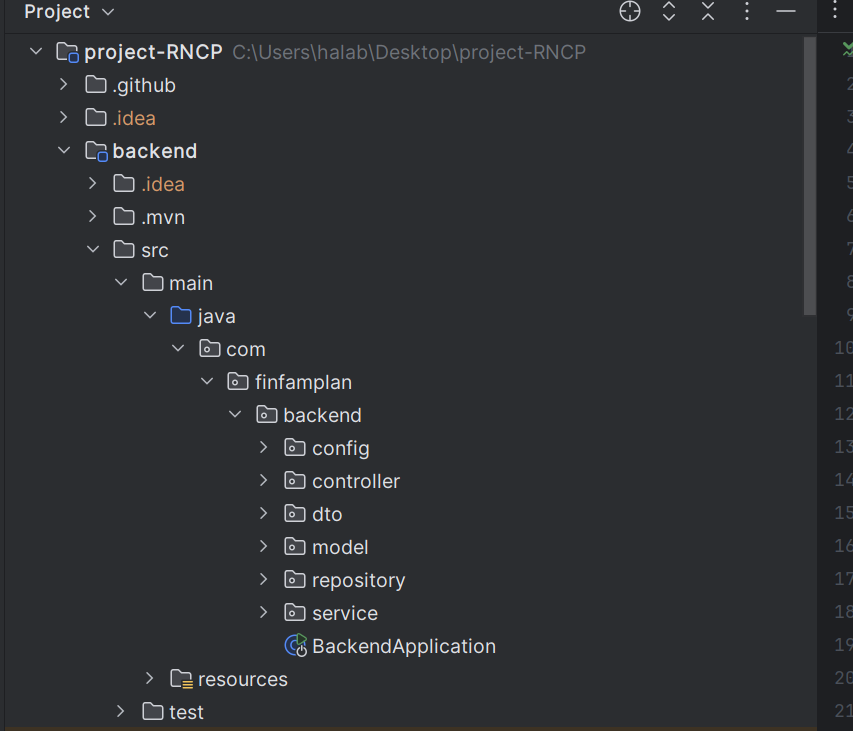
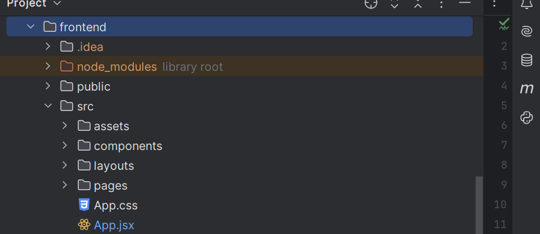
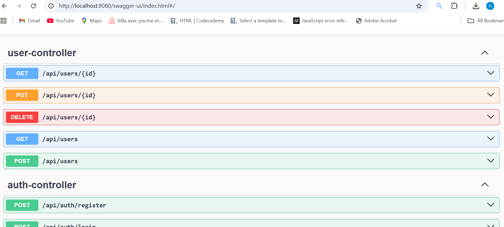

## 🚀 FinFamPlan

FinFamPlan est une application **full-stack de gestion financière familiale**.  
Elle permet l’inscription, la connexion, la gestion de session et un écran d’accueil personnalisé pour les nouveaux utilisateurs.

🎯 **Objectif final** : accompagner les familles dans la gestion de leur budget, de leurs dépenses et de leurs objectifs financiers.

---

## 🧱 Architecture du Projet

Vue globale de l’architecture technique :

```text
┌──────────────────────────────────────────┐
│                FRONTEND                  │
│         React + Vite + TailwindCSS       │
└──────────────────────────┬───────────────┘
                           │ REST API
                           ▼
┌──────────────────────────────────────────┐
│                BACKEND                   │
│               Spring Boot                │
│     Controllers — Services — Repos       │
│  Security: Spring Security + Argon2      │
│  Flyway: DB migrations                   │
└──────────────────────────┬───────────────┘
                           │ JDBC
                           ▼
┌──────────────────────────────────────────┐
│               POSTGRESQL                 │
│               Database                   │
└──────────────────────────────────────────┘
```
---
## 📦 Fonctionnalités Actuelles

🔐 Authentification

- Inscription utilisateur
- Connexion (email + mot de passe)
- Stockage sécurisé des mots de passe avec Argon2 (OWASP recommandé)
  - Redirection automatique :
      -Première connexion → Welcome Page
      -Connexions suivantes → Dashboard

🎨 Frontend

    - React + Vite
    - TailwindCSS
    - Design basé sur Atomic Design
        atoms / molecules / organisms / layouts / pages
    - UI responsive
    - Communication frontend ↔ backend fonctionnelle
    - Routing protégé (préparation pour JWT)

🐳 DevOps

- Projet entièrement dockerisé avec Docker Compose
-     Services :
        Frontend
        Backend
        PostgreSQL
- CI/CD avec GitHub Actions
        Build backend
        Tests backend
        Build frontend
---
## 🛠️ Installation & Lancement

    ▶️ Lancer avec Docker
        docker-compose up --build
    Accès aux services :
        Frontend → http://localhost:5173
        Backend → http://localhost:8080
        PostgreSQL → localhost:5432
    ⏹️ Arrêter les services
        docker-compose down
---
## 🌍 Déploiement (VM, HTTPS sur le port 8443)

Seul le conteneur `frontend` (Caddy : HTTPS, fichiers React et relais de `/api`) est exposé ; le backend et PostgreSQL restent sur le réseau Docker.

1. Créer un sous-domaine DuckDNS pointant vers l'IP publique de la VM et noter le token.
2. Ouvrir le port TCP 8443 en entrée (Security List ou NSG sur OCI).
3. Vérifier la VM : `ss -ltn | grep 8443` (aucun résultat = port libre), `free -h`, `df -h`, `docker compose version`.
4. Envoyer le projet depuis sa racine :

       rsync -avz --exclude .git --exclude .claude --exclude .idea --exclude node_modules \
         --exclude target --exclude dist --exclude .env ./ user@IP:~/finfam/

5. Sur la VM, dans `~/finfam` : `cp .env.prod.example .env && chmod 600 .env`, puis remplir `.env`.
6. Lancer :

       docker compose -f docker-compose.prod.yml up -d --build
       docker compose -f docker-compose.prod.yml logs -f frontend backend

L'application est disponible sur `https://<sous-domaine>.duckdns.org:8443`.
Pour une mise à jour, refaire les étapes 4 et 6.

Retrait complet : `docker compose -f docker-compose.prod.yml down -v --rmi all`, puis supprimer `~/finfam`, la règle 8443 et le domaine DuckDNS.

---
## 💾 Structure du Projet
### Backend
<p align="center">  </p>

### Frontend
<p align="center">  </p>

---
## 💾 Documentation API


---
# 🤝 Contributeur

👤 Hala Chaouat
